<h2>TensorFlow-FlexUNet-Image-Segmentation-Intraretinal-Cystoid-Fluid-OCT (2026/10/28)</h2>
Sarah T. Arai 
Software Laboratory antillia.com  

This is the first experiment of Image Segmentation for <b>Intraretinal-Cystoid-Fluid </b>
 based on
our <a href="https://github.com/sarah-antillia/TensorFlow-FlexUNet-Image-Segmentation-Model">TensorFlowFlexUNet Model</a>
 (<b>TensorFlow Flexible UNet Image Segmentation Model for Multiclass</b>) and a 512x512-pixel cropped PNG
 <a href="https://drive.google.com/file/d/12WjSx71KTYJ9oYQDzy4mYsmGOmNrk03Y/view?usp=sharing">
Intraretinal-Cystoid-Fluid-ImageMask-Dataset.zip</a> (<a href="https://creativecommons.org/licenses/by-nc-sa/4.0/">CC BY-NC-SA 4.0</a>)
which was derived by us from the Kaggle  
  
<a href="https://www.kaggle.com/datasets/zeeshanahmed13/intraretinal-cystoid-fluid">
<b>Intraretinal Cystoid Fluid</b>
</a> by eeshan Ahmed.
  

<b>Actual Image Segmentation for Intraretinal-Cystoid-Fluid Images of 512x512 pixels</b> 
As shown below, the inferred masks resemble the ground-truth masks.  
 
<table>
<tr>
<th width="320" height="auto">Input: image</th>
<th width="320" height="auto">Mask (ground_truth)</th>
<th width="320" height="auto">Prediction: inferred_mask</th>
</tr>
<tr>
<td>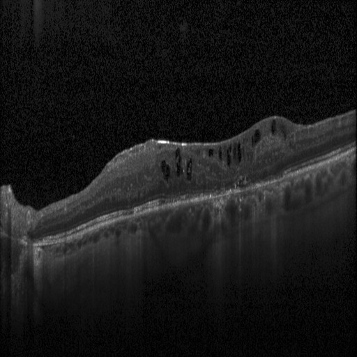</td>
<td>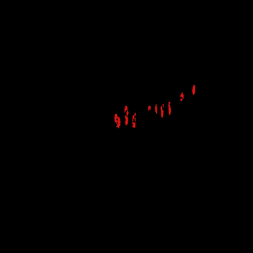</td>
<td>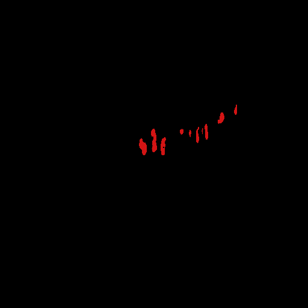</td>
</tr>
<tr>
<td>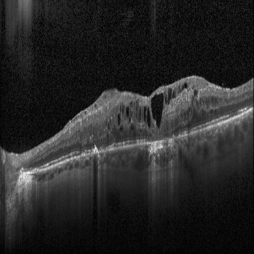</td>
<td></td>
<td></td>
</tr>
<tr>
<td>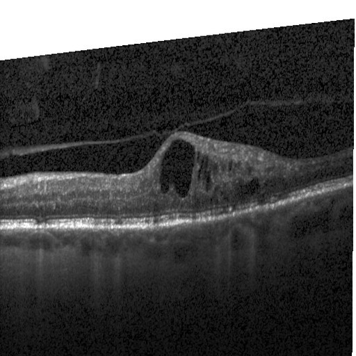</td>
<td></td>
<td></td>
</tr>
</table>

 
<h3>1. Dataset Citation</h3>
The dataset used here was derived from the following Kaggle:  
<a href="https://www.kaggle.com/datasets/zeeshanahmed13/intraretinal-cystoid-fluid">
<b>Intraretinal Cystoid Fluid</b>
</a>  
<b>The diversified ocular disorder
</b> 
by eeshan Ahmed.
  
The following explanation was taken the website above.
  
<b>About Dataset</b> 
The dataset contains the Optical Coherence Tomography (OCT) images and their masks of Cystoid Macular Edema (CME) ocular disease for image segmentation purposes.
  
Acquiring OCT data from Diabetic Macular Edema (DME) patients is difficult due to the lack of an open database from any ophthalmic hospital. Therefore, we obtained a database of retinal images available at Retinal OCT Images in which we took a dataset of only DME subjects. From this dataset, only 1000 images were chosen by the medical experts at Liaquat University of Medical and Health Sciences (LUMHS) Jamshoro, that are trained to identify Cystoid Macular Edema (CME) and its progression and provide a confirmatory diagnosis of CME. Whereas 200 OCT images are taken with the consent of patients from the Institute of Ophthalmology, Jamshoro for the testing set. These OCT images were explicitly selected to contain several CME regions and a wide variety in their shapes and sizes which is utilized for both training and test sets to get better results.
  
In OCT images, the approach of semantic segmentation is that each pixel of an image is labeled with a corresponding clinical class representing a particular disease. The manual binary image masking was performed accordingly using the Image Segmentation application in MATLAB software offers a variety of tools (flood fill/draw freehand) for manually selecting an image region of interest (ROI). This was necessary for the training of our model to identify and isolate the CME and to validate the accuracy of digitally picked ROIs (CME). The pixels whose value is “1” in the mask image indicate the foreground, that is CME, and the pixels whose value is “0” in the mask image indicate the background.
These are the actual ground truth label image and for the given input DME image, the model must predict the labels.
  
This dataset has been arranged and categorized under the supervision of the medical experts at Liaquat University of Medical and Health Sciences (LUMHS) Jamshoro, Pakistan, that are trained to identify CME and its progression and provide a confirmatory diagnosis of CME.
  
<b>Citation</b> 
<pre>
Ahmed Z, Panhwar SQ, Baqai A, Umrani FA, Ahmed M, Khan A. 
Deep learning based automated detection of intraretinal cystoid fluid. Int J Imaging Syst Technol. 2021;1-16.
 https://doi.org/10.1002/ima.22662
</pre>
 
<b>License</b> 
<a href="https://creativecommons.org/licenses/by-nc-sa/4.0/">CC BY-NC-SA 4.0</a>
 
 
<h3>
2. Intraretinal-Cystoid-Fluid ImageMask Dataset
</h3>
<h3>2.1 Download ImageMask Dataset</h3>
 If you would like to train this Intraretinal-Cystoid-Fluid Segmentation model,
 please download the dataset from Google Drive  
 <a href="https://drive.google.com/file/d/12WjSx71KTYJ9oYQDzy4mYsmGOmNrk03Y/view?usp=sharing">
Intraretinal-Cystoid-Fluid-ImageMask-Dataset.zip</a>. 
Expand the downloaded ImageMaskDataset and put it under the <b>./dataset</b> folder.
 
<pre>
./dataset
└─Intraretinal-Cystoid-Fluid
    ├─test
    │   ├─images
    │   └─masks
    ├─train
    │   ├─images
    │   └─masks
    └─valid
         ├─images
         └─masks
</pre>
 
<b>Intraretinal-Cystoid-Fluid Statistics</b> 
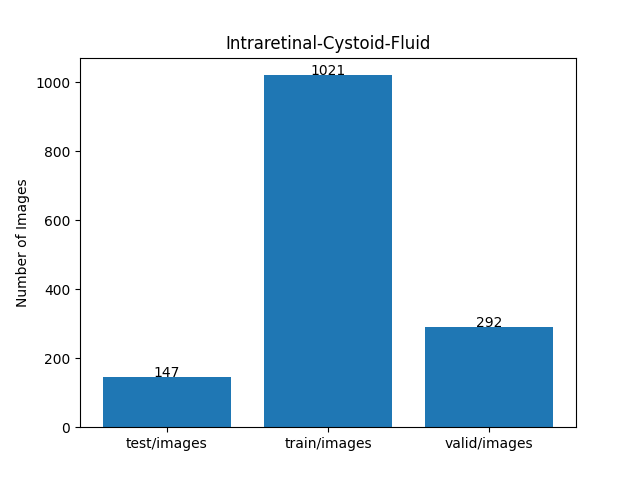 
 
As shown above, the number of images in the training and valid datasets is large enough to use for the
 training set of our segmentation model.
 
<h3>2.2 Derivation of ImageMask Dataset</h3>
The folder structure of the original dataset  
</a> is as follows.
<pre>
./2021-training-data-ZA
  ├─0DME_as_F
  │   ├─images
...
  │   └─masks
  │
  └─DME690
      ├─images
...
      └─masks
</pre>
In this experiment, we generated a 512x512-pixel cropped PNG ImageMask dataset  
from the JPEG files  in images folder and  PNG files  in masks folder in all subfolders
of  <b>2021-training-data-ZA</b> dataset.
  
<h3>2.3 Train Sample Images and Masks</h3>
<b>Train_sample_images</b> 
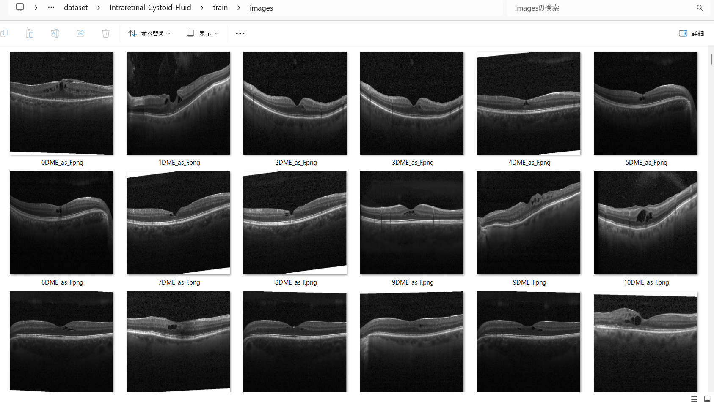
 
<b>Train_sample_masks</b> 
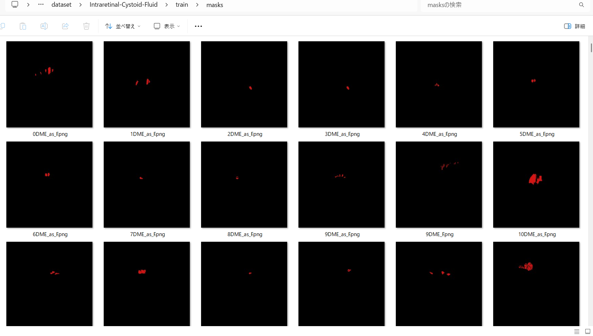
 
<h3>
3. Train TensorFlowFlexUNet Model
</h3>
 We trained the Intraretinal-Cystoid-Fluid TensorFlowFlexUNet model using the following
<a href="./projects/TensorFlowFlexUNet/Intraretinal-Cystoid-Fluid/train_eval_infer.config"> <b>train_eval_infer.config</b></a> file.  
Please move to ./projects/TensorFlowFlexUNet/Intraretinal-Cystoid-Fluid and run the following bat file. 
<pre>
>1.train.bat
</pre>
This runs the following command. 
<pre>
>python ../../../src/TensorFlowFlexUNetTrainer.py ./train_eval_infer.config
</pre>

<b>Model parameters</b> 
Defined a small <b>base_filters=16 </b> and large <b>base_kernels=(11,11)</b> for the first Conv Layer of Encoder Block of 
<a href="./src/TensorFlowFlexUNet.py">TensorFlowFlexUNet.py</a> 
and a large <b>num_layers=8</b> (including a bridge between Encoder and Decoder Blocks).
<pre>
[model]
; You may specify your own UNet class derived from our TensorFlowFlexModel
model         = "TensorFlowFlexUNet"
generator     =  False
image_width    = 512
image_height   = 512
image_channels = 3
num_classes    = 2
base_filters   = 16
base_kernels   = (11,11)
num_layers     = 8
dropout_rate   = 0.03
; Specified a large dilation.
dilation       = (1,1)
</pre>
<b>Learning rate</b> 
Defined a small learning rate.  
<pre>
[model]
learning_rate  = 0.00007
</pre>
<b>Loss and metrics functions</b> 
Specified "categorical_focal_dice_loss" and <a href="./src/dice_coef_multiclass.py">"dice_coef_hybrid"</a>. 
<pre>
[model]
loss           = "categorical_focal_dice_loss"
metrics        = ["dice_coef_hybrid"]
hybrid_alpha   = 1.6
hybrid_beta    = 0.4
</pre>
<b>Dataset class</b> 
Specifed <a href="./src/ImageCategorizedMaskDataset.py">ImageCategorizedMaskDataset</a> class. 
<pre>
[dataset]
class_name    = "ImageCategorizedMaskDataset"
</pre>
 
<b>Learning rate reducer callback</b> 
Enabled the learning_rate_reducer callback and a small reducer_patience.
<pre> 
[train]
learning_rate_reducer = True
reducer_factor     = 0.4
reducer_patience   = 4
</pre>
<b>Early stopping callback</b> 
Enabled early stopping callback with the patience parameter.
<pre>
[train]
patience      = 10
</pre>

<b>RGB Color map</b> 
Specified RGB color map dict for Intraretinal-Cystoid-Fluid 2 classes. 
<pre>
[mask]
mask_datatype= "categorized"
mask_file_format = ".png"
; Intraretinal-Cystoid-Fluid RGB color map dict for 1+1 classes.
;      Background: black,  Fluid:dark_red
rgb_map = {(0,0,0):0,(210,20,20):1,}
</pre>

<b>Epoch change inference callback</b> 
Enabled <a href="./src/EpochChangeInferencer.py">epoch_change_infer callback</a></b>. 
<pre>
[train]
epoch_change_infer       = True
epoch_change_infer_dir   =  "./epoch_change_infer"
num_infer_images         = 6
</pre>

By using this callback, on every epoch change, the inference procedure can be called
 for 6 images in the <b>mini_test</b> folder. This will help you confirm how the predicted mask changes 
 at each epoch during your training process.  
  
<!--
As shown below, early in the model training, the predicted masks from our FlexUNet segmentation model showed 
discouraging results.
 However, as training progressed through the epochs, the predictions gradually improved. 
   
 
-->
<b>Epoch_change_inference output at starting (epoch 1,2,3)</b> 
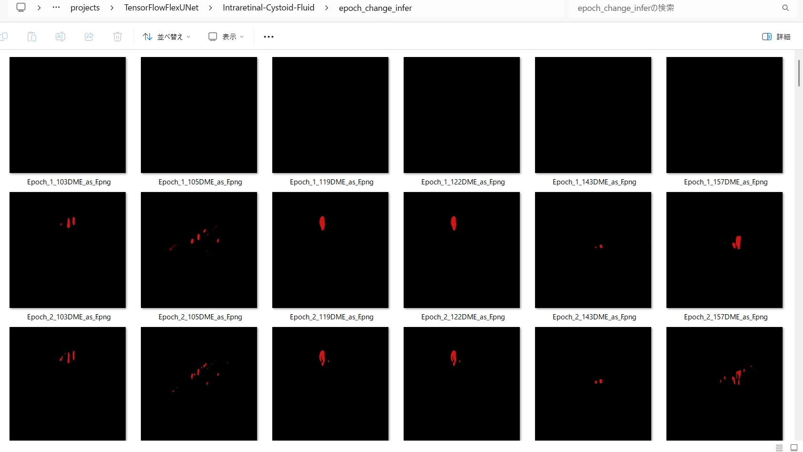 
 
<b>Epoch_change_inference output at middlepoint (epoch 18,19,20)</b> 
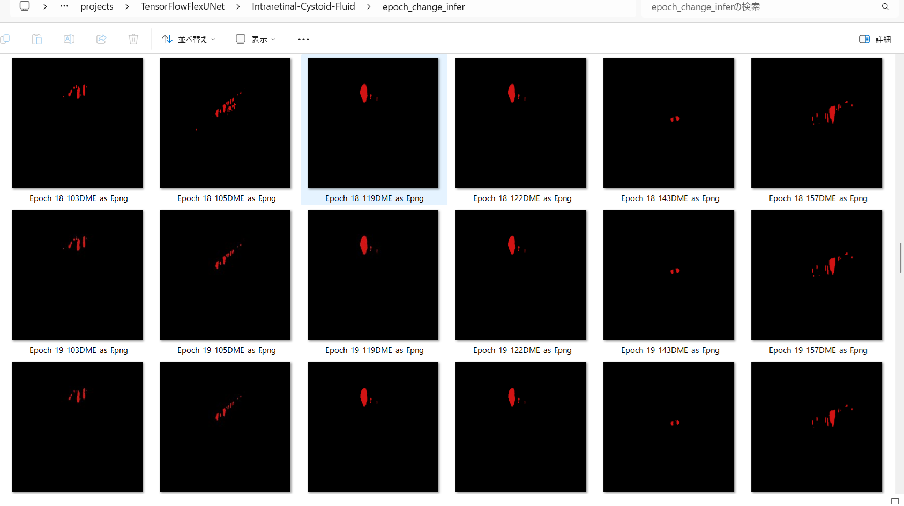 
 
<b>Epoch_change_inference output at ending (epoch 38,39,40)</b> 
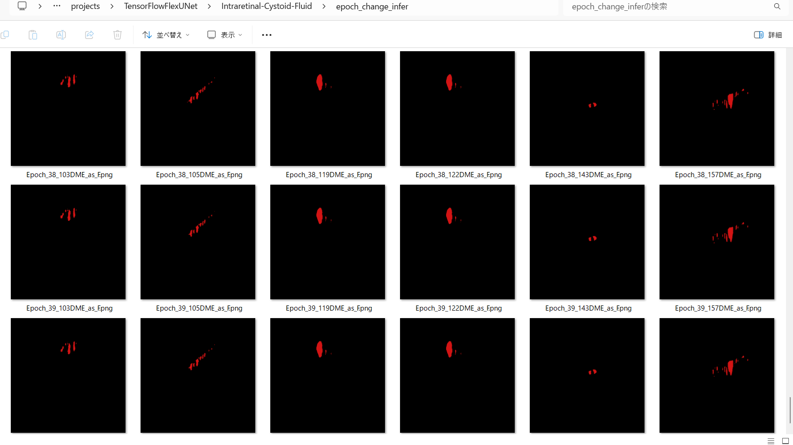 
 
In this experiment, the training process was terminated at epoch 40. 
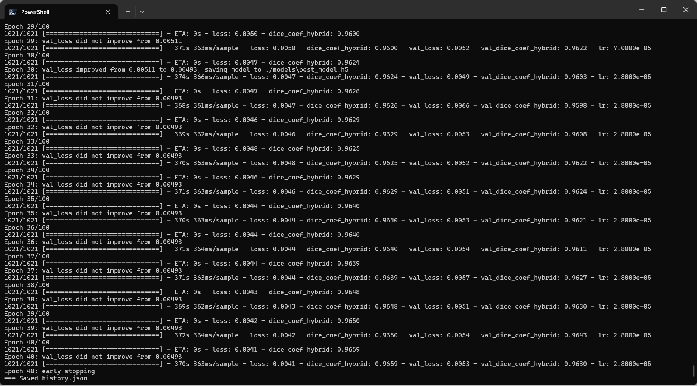 
 
<a href="./projects/TensorFlowFlexUNet/Intraretinal-Cystoid-Fluid/eval/train_metrics.csv">train_metrics.csv</a> 
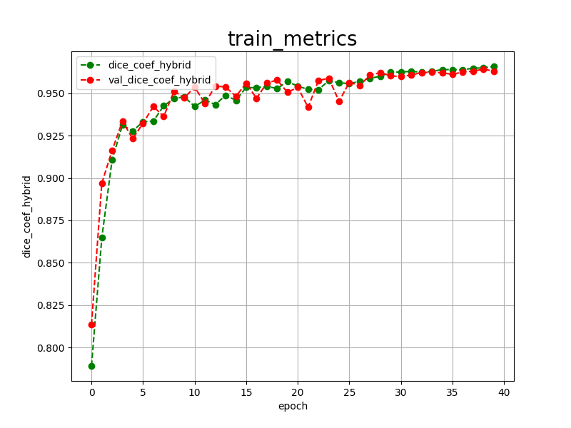 
 
<a href="./projects/TensorFlowFlexUNet/Intraretinal-Cystoid-Fluid/eval/train_losses.csv">train_losses.csv</a> 
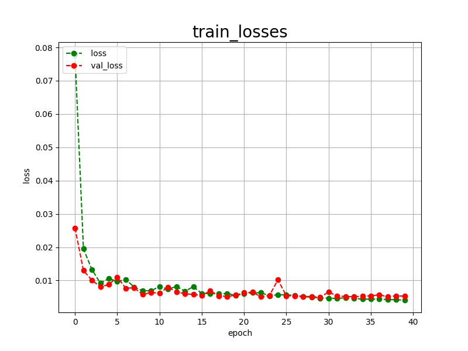 
 
<h3>
4. Evaluation
</h3>
Please move to <b>./projects/TensorFlowFlexUNet/Intraretinal-Cystoid-Fluid</b> folder, 
and run the following bat file to evaluate the TensorFlowUNet model for Intraretinal-Cystoid-Fluid. 
<pre>
./2.evaluate.bat
</pre>
This runs the following command.
<pre>
python ../../../src/TensorFlowFlexUNetEvaluator.py ./train_eval_infer.config
</pre>

Evaluation console output: 
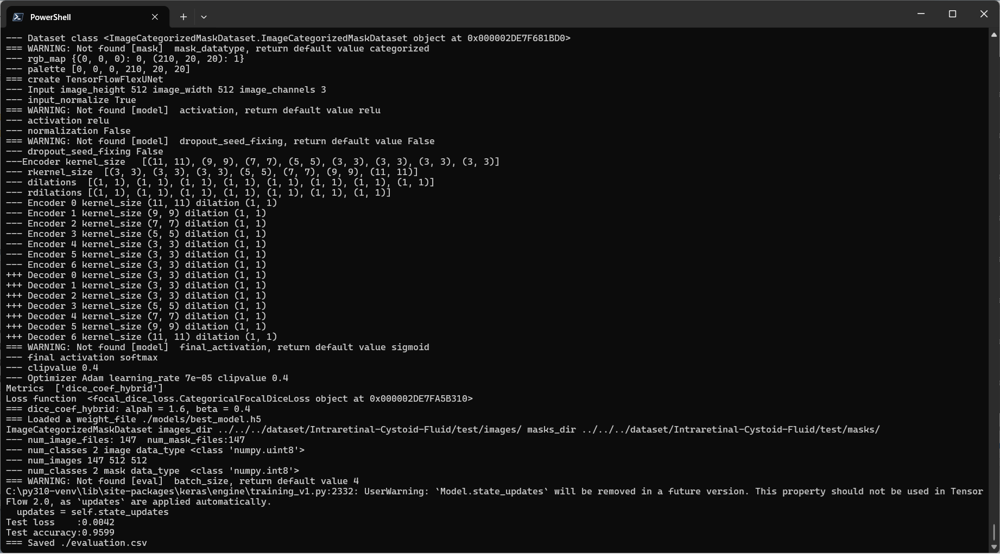
  Image-Segmentation-Intraretinal-Cystoid-Fluid

<a href="./projects/TensorFlowFlexUNet/Intraretinal-Cystoid-Fluid/evaluation.csv">evaluation.csv</a> 
The loss (categorical_focal_dice_loss) on this Intraretinal-Cystoid-Fluid/test was low, and dice_coef_hybrid was high, as shown below.
 
<pre>
categorical_focal_dice_loss,0.0042
dice_coef_hybrid,0.9599
</pre>
 

<h3>
5. Inference
</h3>
Please move to <b>./projects/TensorFlowFlexUNet/Intraretinal-Cystoid-Fluid</b> folder
and run the following bat file to infer segmentation regions for images using the trained TensorFlowUNet model for Intraretinal-Cystoid-Fluid. 
<pre>
./3.infer.bat
</pre>
This runs the following command.
<pre>
python ../../../src/TensorFlowFlexUNetInferencer.py ./train_eval_infer.config
</pre>

<b>mini_test_images</b> 
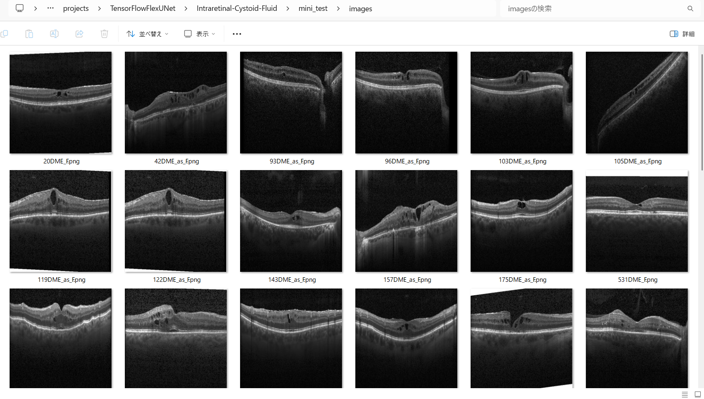 
<b>mini_test_mask(ground_truth)</b> 
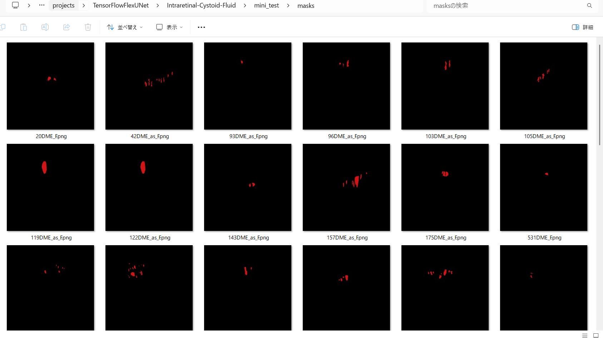 

<b>Inferred test masks</b> 
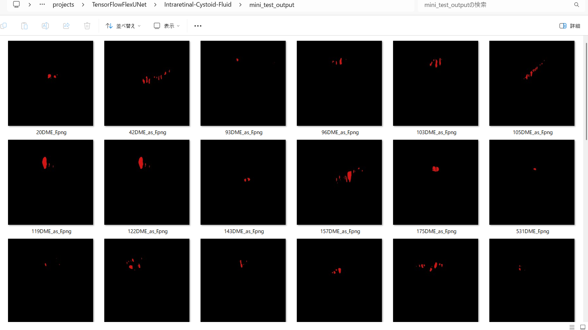 
 

<b>Enlarged images and masks for Intraretinal-Cystoid-Fluid Images of 512x512 pixels</b> 
As shown below, the inferred masks look similar to the ground truth masks. 
 
<table>
<tr>
<th width="320" height="auto">Image</th>
<th width="320" height="auto">Mask (ground_truth)</th>
<th width="320" height="auto">Inferred-mask</th>
</tr>
<tr>
<td>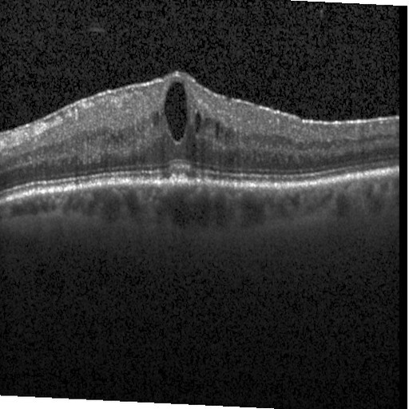</td>
<td></td>
<td>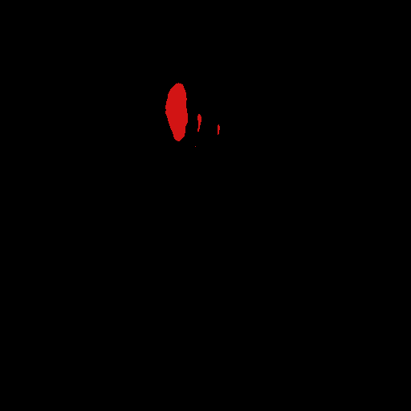</td>
</tr>
<tr>
<td></td>
<td></td>
<td></td>
</tr>
<tr>
<td>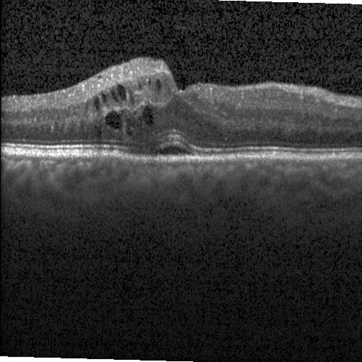</td>
<td></td>
<td></td>
</tr>
<tr>
<td>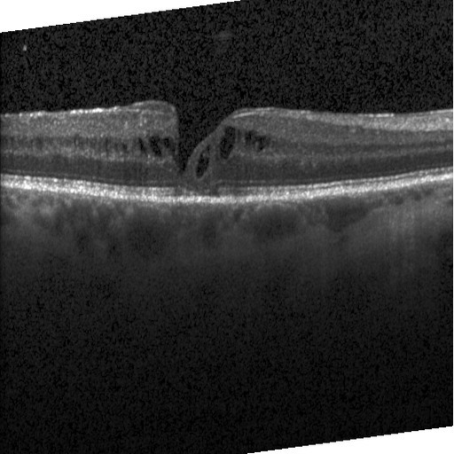</td>
<td></td>
<td></td>
</tr>
<tr>
<td></td>
<td></td>
<td></td>
</tr>
<tr>
<td>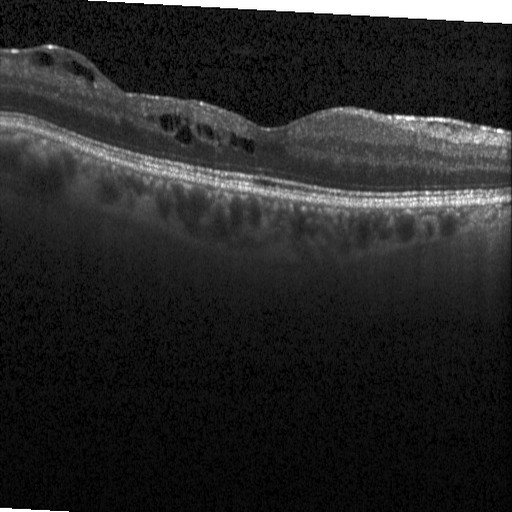</td>
<td></td>
<td>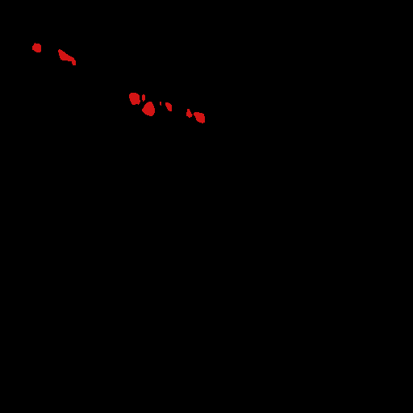</td>
</tr>
</table>

 
<h3>
References
</h3>

<b>1. TensorFlow-FlexUNet-Image-Segmentation-Retinal-Vein-Occlusion-Macular-Edema-OCT  </b> 
Toshiyuki Arai 
<a href="https://github.com/sarah-antillia/TensorFlow-FlexUNet-Image-Segmentation-Retinal-Vein-Occlusion-Macular-Edema-OCT">
https://github.com/sarah-antillia/TensorFlow-FlexUNet-Image-Segmentation-Retinal-Vein-Occlusion-Macular-Edema-OCT
</a>
  
<b>2. TensorFlow-FlexUNet-Image-Segmentation-Optical-Coherence-Tomography-AMD</b> 
Toshiyuki Arai 
<a href="https://github.com/sarah-antillia/TensorFlow-FlexUNet-Image-Segmentation-Optical-Coherence-Tomography-AMD">
https://github.com/sarah-antillia/TensorFlow-FlexUNet-Image-Segmentation-Optical-Coherence-Tomography-AMD
</a>
  
<b>3. TensorFlow-FlexUNet-Image-Segmentation-Model</b> 
Toshiyuki Arai 
<a href="https://github.com/sarah-antillia/TensorFlow-FlexUNet-Image-Segmentation-Model">
https://github.com/sarah-antillia/TensorFlow-FlexUNet-Image-Segmentation-Model
</a>
  
